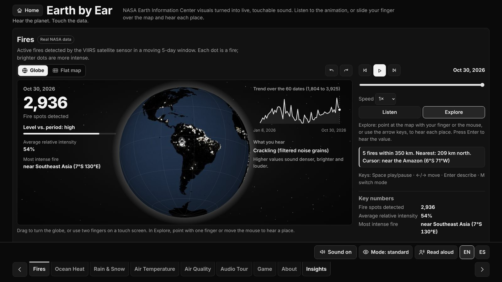
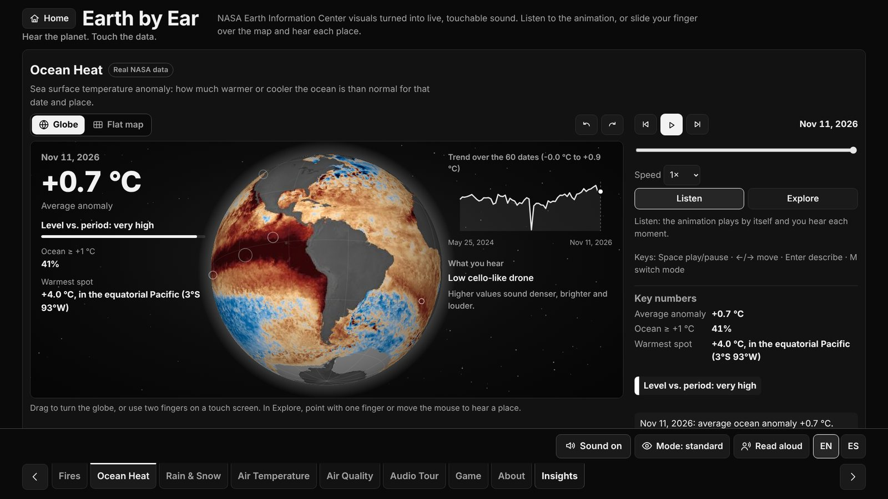
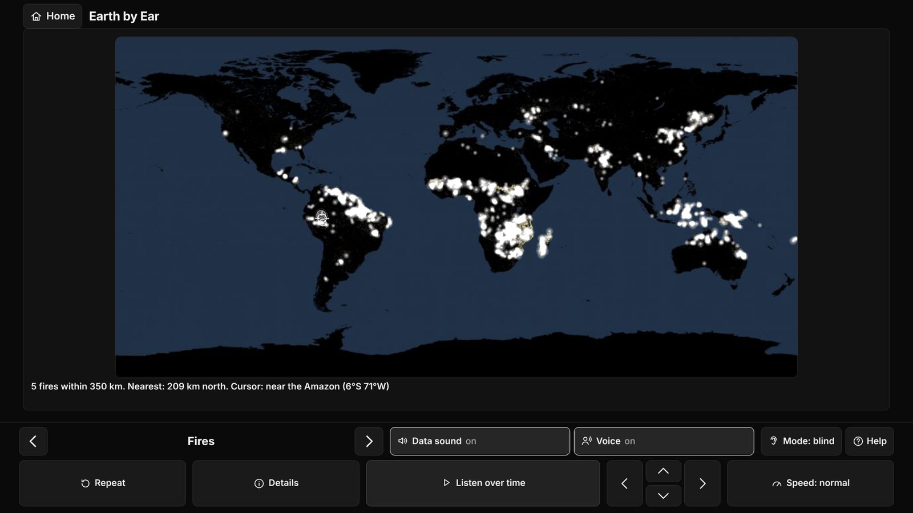
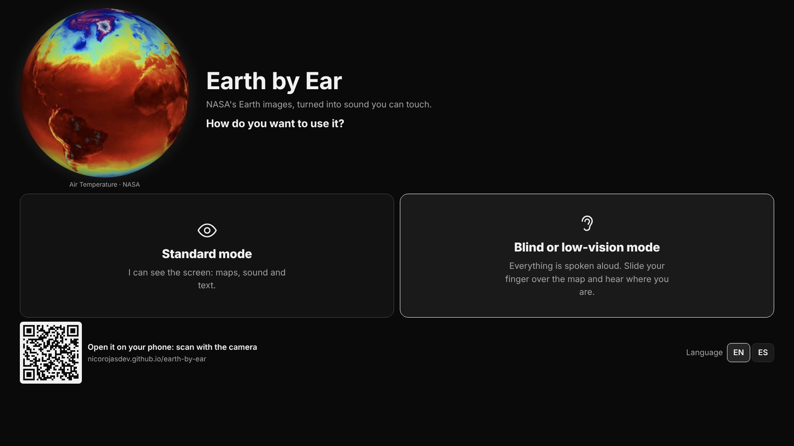
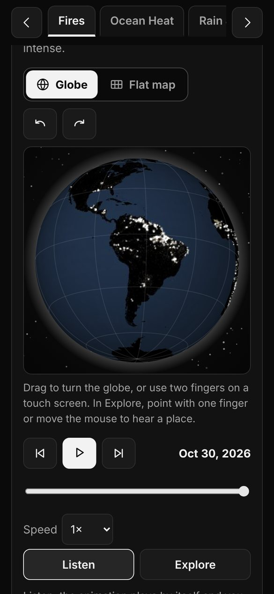
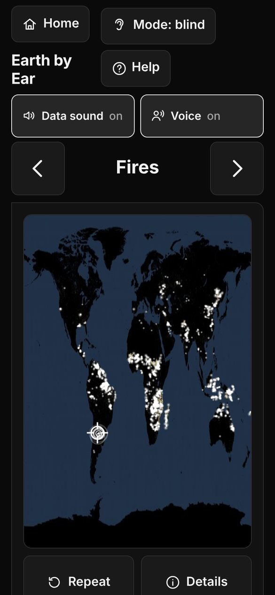

# Earth by Ear

**Hear the planet. Touch the data.**

Earth by Ear turns NASA's Earth Information Center (EIC) visualizations into live sound that you can touch. Turn a 3D globe wrapped in real NASA frames, point at any place and hear its fires, ocean heat, rain, air temperature or air pollution, with or without seeing the screen.

**▶ Try it:** https://nicorojasdev.github.io/earth-by-ear/ (any phone, tablet, computer or giant screen; nothing to install; English and Spanish)
**Museum kiosk:** https://nicorojasdev.github.io/earth-by-ear/?kiosk=1

Built for the **NASA International Space Apps Challenge 2026**, challenge ***The Earth Information Jukebox***, by team **Moroncitos**: **Nicolás Rojas, Juan Sayago and Lucas Orellana**, data scientists (Data Science and AI, ITSE, Santiago del Estero, Argentina).

📄 **Informe en español (Spanish report):** [`pitch/informe-es.md`](pitch/informe-es.md)



## Why

The EIC shows the state of the planet on video walls, in museums and on the web, but almost only with images. People who are blind or have low vision are left out, and a visitor in a busy hall looks at a map for a few seconds without learning much from it. Earth by Ear adds a sound layer to the same NASA visuals. Every sound is computed from values read from the real frames, so listening is another way to read the data, not a soundtrack.

## Results

| Claim | Evidence |
|---|---|
| **People can hear the data** | Listening game with **20 people**: **95%** named the phenomenon from a 3-second clip (chance: 20%) and **85%** also got its intensity right (chance: 33%). One-sided binomial test, p < 0.0001 for both. |
| **The data is real** | The fire spots we read from the EIC frames rise and fall with **NASA FIRMS** VIIRS detections: rank correlation **0.67–0.94** in five regions and **0.93** over 300 region × window pairs in 2026. |
| **The mix is fair** | A loudness meter on the app's output keeps the five instruments within about **4 dB** of each other, on headphones and on phone speakers. |
| **It is accessible** | Automated WCAG 2.1 AA checks (axe-core) report **0 issues** on every screen we test, in both modes and both languages. |

Details, charts and limits: [`pitch/validation.md`](pitch/validation.md).

## What it does

**Two modes, chosen on the welcome screen.**

| Standard mode | Blind or low-vision mode |
|---|---|
|  |  |
| A 3D globe (or a flat map) wrapped in the real EIC frame. Drag to turn it, or use two fingers on a touch screen; point with one finger or the mouse to hear a place. | Sound and voice start on their own and spoken instructions explain the screen. Sliding a finger says the continent or ocean; lifting it says the value. *Details* reads the date, place, value with its units, intensity and the world average. |

- **Five phenomena, five instruments.** Fires (crackling), ocean heat (cello-like drone), rain and snow (drops), air temperature (warm pad and whistle) and air quality (muffled rumble).
- **Listen:** the animation plays like a jukebox. Higher values sound denser, brighter and louder; a tense chord comes in when a moment is above the period average. The globe turns slowly while you listen.
- **Explore:** hear the value under your finger, the mouse or the arrow keys. For fires, a sonar speeds up as you get closer to the nearest fire.
- **Audio Tour:** a narrated tour of the five phenomena that does not need the screen.
- **Game:** 10 rounds to name the phenomenon and its intensity by ear. It is also how we measured whether the sounds work.
- **Insights:** what we learned from the data as data science students: key numbers, six problems with what the data shows and possible solutions, and how we got the numbers.

**Made first for museum giant screens.**

- **Kiosk mode** (`?kiosk=1`): after 5 minutes without use it goes back to a welcome screen with a turning Earth wrapped in the same NASA frames; a QR code there opens the app on visitors' phones.
- **Everything within reach:** on screens 1600 px wide or more, all buttons and tabs move to a bar at the bottom of the screen, where seated visitors and children can reach them.
- **Blind mode on a wall:** four arrows move the cursor over the map (tap for one step, hold to keep moving, three speeds), so a visitor does not need to reach the whole screen. Buttons grow or shrink with the screen.

| Welcome screen | Phone, globe | Phone, blind mode |
|---|---|---|
|  |  |  |

**Accessible by design:** keyboard and screen reader support (ARIA tabs, live regions), text descriptions generated from the same numbers as the sound, an optional read-aloud voice in the chosen language, single-pointer alternatives for every gesture (turn buttons, cursor arrows), and a still globe when the device asks for reduced motion.

## Try it in one minute

1. Open the link, choose **Standard mode** and turn the sound on.
2. On **Fires**, press **Explore** and point at South America on the globe: the crackles get denser near the fires of the Amazon and the Gran Chaco.
3. Drag the globe (or use two fingers) to turn it; press **Flat map** to see the whole world at once.
4. Open **Insights** for what the data says, then press **Start** and try the **blind mode** with your eyes closed.

## How it works

```
NASA SVS (EIC frames) → download_raw.py → build_data.py → docs/data/*.js + frames → web app (docs/)
                                          colorbar → values                         Web Audio + Web Speech,
                                          2° grid / fire spots                      flat map or 3D globe
```

1. `scripts/download_raw.py` downloads the EIC visualizations from NASA's Scientific Visualization Studio (SVS).
2. `scripts/build_data.py` reads each frame, turns pixel colors into values with the visualization's own colorbar (nearest color in Lab space), and writes a 2-degree grid, or a list of fire spots, to `docs/data/<id>.js`, plus the frame images. Settings are in `scripts/phenomena.json`.
3. The web app (`docs/`) is plain HTML, CSS and JavaScript with no libraries and no API calls. It synthesizes every sound live with the Web Audio API, speaks with the Web Speech API and draws the globe itself (orthographic projection of the real frame on a canvas).
4. `scripts/validate_firms.py` compares our fire spots with NASA FIRMS, and `scripts/analyze_game.py` tests game results against chance.

To rebuild the data on Windows: `.venv/Scripts/python scripts/download_raw.py`, then `.venv/Scripts/python scripts/build_data.py --all`. GitHub Pages serves `docs/` as it is.

## Repository

| Path | What is there |
|---|---|
| `docs/` | The web app (GitHub Pages): `index.html`, `css/`, `js/` (map and globe, audio engine, instruments, tabs, game, tour, insights, translations) and `data/` |
| `scripts/` | Python data pipeline and validation; `scripts/windows/` has double-click helpers |
| `pitch/` | Validation, game results, submission texts, video scripts and subtitles, screenshots, data audit and a summary PDF |
| `CLAUDE.md` | Our working notes and decisions, in Spanish |

## Data

All visualizations are from NASA's Scientific Visualization Studio, Earth Information Center collection (https://svs.gsfc.nasa.gov/gallery/earth-information-center/):

| Tab | Visualization |
|---|---|
| Fires | [SVS 5113](https://svs.gsfc.nasa.gov/5113/) Active Fires As Observed by VIIRS, 2024-Present |
| Ocean Heat | [SVS 5176](https://svs.gsfc.nasa.gov/5176/) Sea Surface Temperature (SST) Anomaly - Near Real Time |
| Rain & Snow | [SVS 4285](https://svs.gsfc.nasa.gov/4285/) Near Real-Time Global Precipitation (IMERG) |
| Air Temperature | [SVS 5147](https://svs.gsfc.nasa.gov/5147/) GEOS-FP Near-Surface Temperature |
| Air Quality | [SVS 5151](https://svs.gsfc.nasa.gov/5151/) Particulate Matter (PM) 2.5 |

NASA FIRMS (https://firms.modaps.eosdis.nasa.gov/) is our reference for cross-checking fire detections. The audit of each source is in [`pitch/data-audit.md`](pitch/data-audit.md).

Credit: NASA's Scientific Visualization Studio.

## Limitations

- Values are read from image colors, not from calibrated measurements, so they are approximations; values beyond a colorbar are shown at its limit.
- The 2-degree grid (about 220 km) averages out local detail.
- Fire intensity is relative (colorbar color plus cluster size). Where fires are very dense, nearby fires merge into one cluster, so those regions get fewer crackles than they deserve.
- Fire data stops at the end of October 2026 because the satellite feed behind the visualization stopped in early November.
- The listening game had 20 people from around the team, not a random sample of museum visitors. **Next step:** test with blind and low-vision visitors and with a museum.

## AI disclosure

This project was built with the assistance of **Claude (Anthropic)** for writing code and documentation. Every code file starts with a one-line comment that says so. All sounds are synthesized live in the browser by our own code; no AI-generated audio, images or video are used.

## Team

**Moroncitos** · NASA Space Apps Challenge 2026 · *The Earth Information Jukebox*

| Name | Role |
|---|---|
| Nicolás Rojas | Data scientist |
| Juan Sayago | Data scientist |
| Lucas Orellana | Data scientist |

Data Science and AI students at ITSE, Santiago del Estero, Argentina.

## License

MIT. See [LICENSE](LICENSE).
