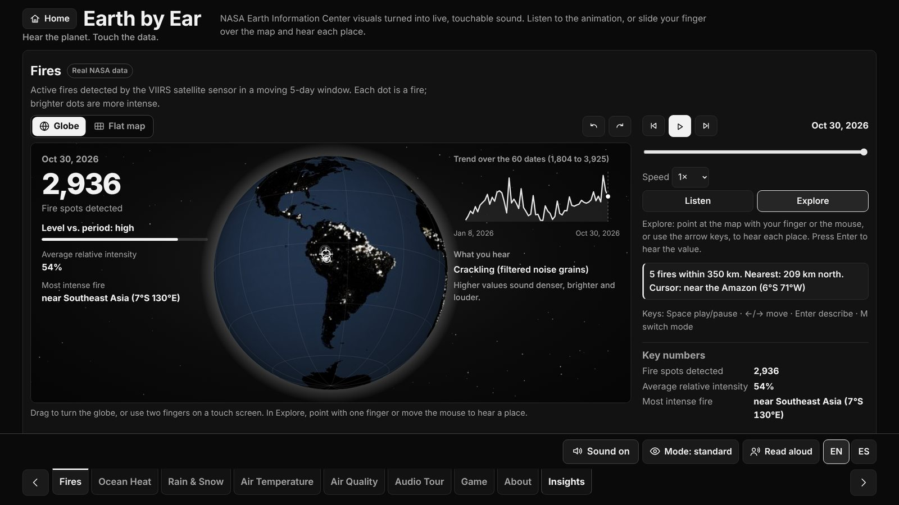
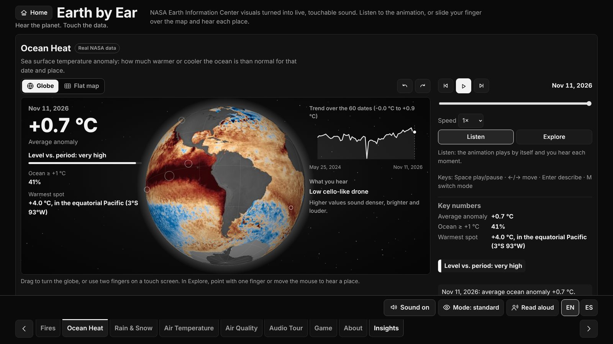
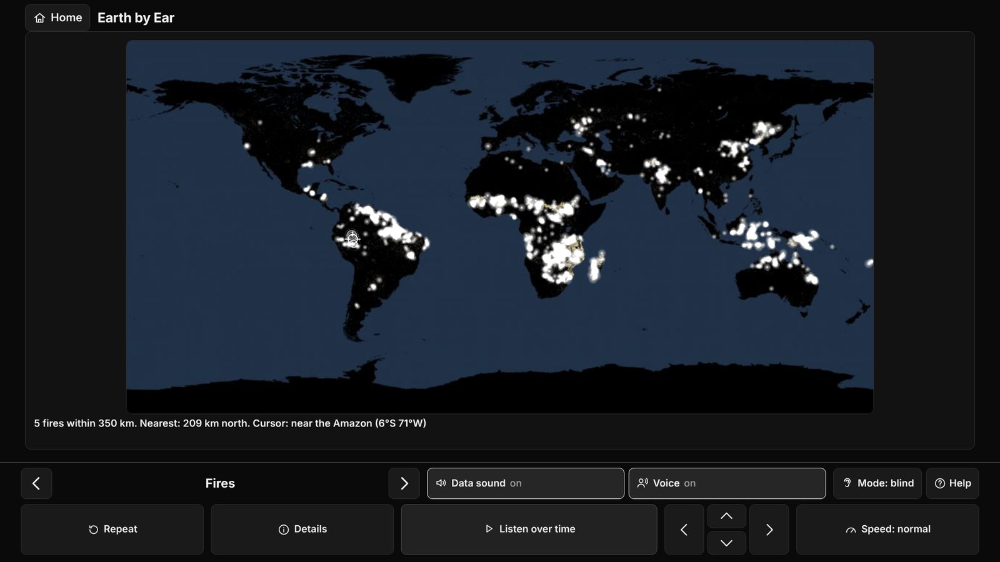

# Earth by Ear — Informe del proyecto

> **Escuchá el planeta. Tocá los datos.**
> NASA International Space Apps Challenge 2026 · Versión final, domingo 15 de noviembre de 2026.

| | |
|---|---|
| **Proyecto** | Earth by Ear |
| **Desafío** | *The Earth Information Jukebox* (NASA Space Apps Challenge 2026) |
| **Equipo** | **Moroncitos** |
| **Integrantes** | Nicolás Rojas, Juan Sayago y Lucas Orellana, científicos de datos (Tecnicatura en Ciencia de Datos e Inteligencia Artificial, ITSE, Santiago del Estero, Argentina) |
| **App (en español con el botón ES)** | https://nicorojasdev.github.io/earth-by-ear/ |
| **Modo museo (kiosco)** | https://nicorojasdev.github.io/earth-by-ear/?kiosk=1 |
| **Código y documentación** | https://github.com/NicoRojasDev/earth-by-ear |

## 1. Resumen

Earth by Ear convierte las visualizaciones del Earth Information Center (EIC) de la NASA en sonido en vivo que se puede tocar. Está pensada primero para las pantallas gigantes de museos y centros de ciencia, donde ya vive el EIC. Cinco visualizaciones del EIC (incendios activos, calor del océano, lluvia y nieve, temperatura del aire y contaminación del aire) tienen cada una su instrumento, y cada sonido se calcula con valores leídos de los cuadros reales del EIC usando la barra de colores de cada visualización. El público gira un globo 3D envuelto en esas imágenes, señala un lugar y la sala escucha el planeta. Un modo simple para personas ciegas o con baja visión dice todo en voz alta. En una prueba de escucha, 19 de 20 personas reconocieron el fenómeno solo con el oído, y los incendios que leemos suben y bajan junto con los registros oficiales de NASA FIRMS (correlación de rangos 0,93).

## 2. El problema

- El EIC muestra el estado del planeta en paredes de video, museos y en la web, pero casi solo con imágenes.
- Según la OMS, al menos **2.200 millones de personas** en el mundo tienen alguna deficiencia visual. Para ellas, una exhibición climática hecha de mapas de colores queda cerrada.
- Incluso quien ve bien mira un mapa unos segundos en una sala llena de gente y se lleva poca información.
- En nuestra provincia el tema es cercano: en los datos que usamos, los incendios de Santiago del Estero tuvieron su pico a fines de agosto y principios de septiembre de 2026, y del 10 al 12 de noviembre la celda más caliente del planeta estuvo en el Gran Chaco, al lado de nuestra ciudad (hasta 39 °C).

## 3. La solución

**Dos modos, que se eligen en la pantalla de bienvenida.**

| Modo común | Modo para personas ciegas o con baja visión |
|---|---|
|  |  |
| Un globo 3D (o un mapa plano) con la imagen real del EIC. Se gira arrastrando, o con dos dedos en pantallas táctiles; se señala con un dedo o el mouse para escuchar un lugar. Al costado del globo se ven la fecha, el número principal, el nivel respecto del período y la tendencia de las 60 fechas. | El sonido y la voz arrancan solos y unas instrucciones habladas explican la pantalla. Al deslizar el dedo se dice el continente u océano; al levantarlo, el valor. *Detalles* lee fecha, lugar, valor con unidades, intensidad y promedio mundial. |

- **Cinco fenómenos, cinco instrumentos:** incendios (chisporroteo), calor del océano (zumbido grave tipo violonchelo), lluvia y nieve (gotas), temperatura del aire (colchón cálido y silbido) y calidad del aire (rumor apagado).
- **Escuchar:** la animación avanza como una rocola. Los valores más altos suenan más densos, más brillantes y más fuertes; un acorde tenso entra cuando un momento está por encima del promedio del período.
- **Explorar:** se escucha el valor bajo el dedo, el mouse o las flechas del teclado. En incendios, un sonar se acelera al acercarse al foco más cercano.
- **Recorrido sonoro:** una visita narrada por los cinco fenómenos que no necesita mirar la pantalla.
- **Juego:** 10 rondas para adivinar el fenómeno y su intensidad de oído. También sirvió para medir si los sonidos se entienden.
- **Hallazgos:** lo que aprendimos de los datos como científicos de datos: cifras clave, seis problemas con lo que muestran los datos y posibles soluciones.

**Pensada para pantallas gigantes de museo:**

- **Modo kiosco** (`?kiosk=1`): a los 5 minutos sin uso vuelve a la bienvenida con la Tierra girando; un código QR abre la app en el celular de cada visitante.
- **Todo al alcance de la mano:** en pantallas de 1600 px o más, los botones y pestañas bajan a una barra en la parte inferior, para personas sentadas y para chicos.
- **Modo para ciegos en una pared:** cuatro flechas mueven el cursor (tocar = un paso, mantener = seguir, con tres velocidades), así no hace falta llegar a toda la pantalla. Los botones se adaptan al tamaño de la pantalla.
- **Botón Inicio** arriba de todo para volver a la bienvenida.

## 4. Datos de la NASA que usamos

Todas las visualizaciones son del Scientific Visualization Studio (SVS) de la NASA, colección Earth Information Center (https://svs.gsfc.nasa.gov/gallery/earth-information-center/):

| Pestaña | Visualización de la NASA |
|---|---|
| Incendios | [SVS 5113](https://svs.gsfc.nasa.gov/5113/) Active Fires As Observed by VIIRS, 2024-Present |
| Calor del mar | [SVS 5176](https://svs.gsfc.nasa.gov/5176/) Sea Surface Temperature (SST) Anomaly - Near Real Time |
| Lluvia y nieve | [SVS 4285](https://svs.gsfc.nasa.gov/4285/) Near Real-Time Global Precipitation (IMERG) |
| Temperatura del aire | [SVS 5147](https://svs.gsfc.nasa.gov/5147/) GEOS-FP Near-Surface Temperature |
| Calidad del aire | [SVS 5151](https://svs.gsfc.nasa.gov/5151/) Particulate Matter (PM) 2.5 |

Para validar los incendios usamos **NASA FIRMS** (https://firms.modaps.eosdis.nasa.gov/), detecciones VIIRS (Suomi NPP). Inspiración: *Data Sonification: Caldwell 73* (https://svs.gsfc.nasa.gov/13786/). Crédito: NASA's Scientific Visualization Studio.

## 5. Cómo funciona (la parte de ciencia de datos)

1. **Descarga:** `scripts/download_raw.py` baja las visualizaciones del SVS.
2. **Lectura de los cuadros:** `scripts/build_data.py` toma 60 cuadros por fenómeno y convierte cada color de píxel en un valor con la barra de colores de esa visualización (color más cercano en el espacio Lab). Los campos se promedian en una grilla de 2° ponderada por área; los incendios se detectan como grupos de píxeles cálidos. Se enmascaran logos y fechas, y los píxeles que no coinciden con ningún color de la barra se descartan en vez de inventarse.
3. **Datos livianos:** el resultado se guarda en archivos JavaScript chicos, así la web no llama a ninguna API y funciona sin conexión una vez cargada.
4. **Sonido en el navegador:** con la Web Audio API se sintetiza todo en vivo, un instrumento por fenómeno, en escala pentatónica y con limitador. Oeste–este va de izquierda a derecha; en Explorar, norte–sur cambia la altura del sonido. La voz usa la Web Speech API en el idioma elegido.
5. **Globo 3D propio:** proyección ortográfica de la imagen real dibujada en un canvas, sin librerías externas.

## 6. Validación

| Afirmación | Evidencia |
|---|---|
| **La gente escucha los datos** | Juego con **20 personas**: 17 acertaron fenómeno e intensidad, 2 solo el fenómeno y 1 ninguno. Fenómeno: **95%** (al azar 20%). Intensidad: **85%** (al azar 33%). Test binomial de una cola: p < 0,0001 en ambos. |
| **Los datos son reales** | Los focos que leemos del video del EIC suben y bajan con las detecciones oficiales de **NASA FIRMS**: correlación de rangos de **0,67 a 0,94** en cinco regiones y **0,93** en los 300 pares región × ventana de 2026 (p < 0,001). |
| **La mezcla es pareja** | Un medidor de sonoridad sobre la salida de la app deja los cinco instrumentos a menos de **4 dB** entre sí (antes 13 dB), con auriculares y con parlante de celular. |
| **Es accesible** | La auditoría automática WCAG 2.1 A/AA (axe-core) da **0 problemas** en todas las pantallas probadas, en los dos modos y los dos idiomas. |
| **Controles de cordura** | La temperatura media del aire que leemos (15,4 °C) coincide con el promedio global conocido (~15 °C). |

Detalle completo (en inglés): [`validation.md`](validation.md).

## 7. Hallazgos principales

- **0,93:** correlación entre nuestros focos de incendio y NASA FIRMS.
- **75%** del océano estaba más caliente que lo normal el 11 de noviembre de 2026; el 41%, al menos 1 °C más.
- **39 °C** en el Gran Chaco, la celda más caliente del planeta del 10 al 12 de noviembre de 2026.
- **De 1.804 a 3.925** focos de incendio por ventana de 5 días entre el momento más tranquilo (17 de junio) y el más activo (20 de octubre).
- **225 µg/m³** de PM2.5 en el norte de China el 13 de noviembre; el 2,5% del planeta superaba la guía diaria de la OMS (15 µg/m³).

## 8. Impacto

- Abre las exhibiciones climáticas de la NASA a personas ciegas o con baja visión, y a cualquiera que aprende mejor escuchando.
- Funciona en pantallas de museo, computadoras y celulares, en español e inglés, gratis y sin instalar nada.
- Acerca los datos a nuestra realidad: los incendios del Gran Chaco y el calor de Santiago del Estero se pueden escuchar.

## 9. Limitaciones y próximos pasos

- Los valores salen de colores de imagen, no de mediciones calibradas: son aproximaciones, y los valores que pasan el límite de la barra de colores quedan en ese límite.
- La grilla de 2° (unos 220 km) promedia el detalle local.
- La intensidad de los incendios es relativa; donde hay muchísimos focos juntos se fusionan y suenan menos de lo que deberían.
- Los datos de incendios terminan a fines de octubre de 2026 porque el satélite detrás de la visualización dejó de enviar datos a principios de noviembre.
- La prueba de escucha fue con 20 personas cercanas al equipo, no una muestra al azar de visitantes.
- **Próximos pasos:** probar con personas ciegas y con baja visión y con organizaciones locales, llevarlo a un museo, sumar más visualizaciones del EIC y un modo "orquesta de celulares".

## 10. Uso de inteligencia artificial

Usamos Claude (Anthropic), un modelo de lenguaje, como asistente de programación y redacción: escribió y probó gran parte del código y redactó documentación bajo nuestra dirección. Cada archivo de código empieza con un comentario que lo dice, y también lo dicen el README y la pestaña Acerca de. Todos los sonidos los sintetiza nuestro código en el navegador; no se usaron audio, imágenes ni video generados por IA.

## 11. Herramientas

HTML, CSS y JavaScript (sin frameworks), Web Audio API, Web Speech API, Python 3.12, OpenCV, NumPy, pandas, requests, axe-core, Git y GitHub Pages.

---

Equipo **Moroncitos** · Nicolás Rojas, Juan Sayago y Lucas Orellana · Científicos de datos · ITSE, Santiago del Estero, Argentina.
