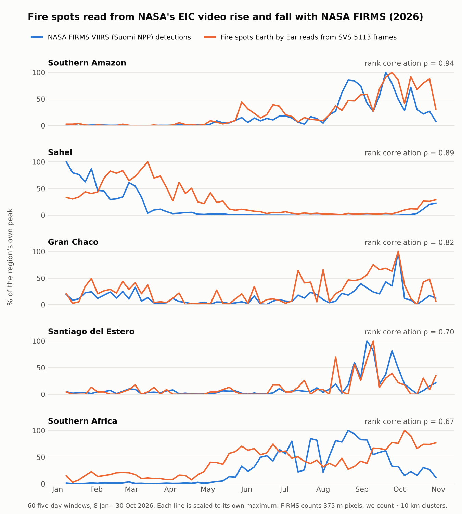

# Validation

> Written with the assistance of Claude (Anthropic) for NASA Space Apps 2026. Last update: Saturday 14 Nov 2026.

Earth by Ear makes three claims. Each one is checked here with data, and the limits are stated.

1. **The data is real:** the fires we read from the EIC video follow NASA's own fire records (FIRMS).
2. **The mix is fair:** no phenomenon is drowned out by another, on headphones or on a phone speaker.
3. **People can hear the data:** listeners recognize the phenomenon and its intensity better than chance (listening game).

---

## 1. Our fire spots follow NASA FIRMS

**Question.** The Fires tab does not use a fire database: it reads the colored dots of the EIC visualization *Active Fires As Observed by VIIRS, 2024-Present* (SVS 5113) and turns them into fire spots. Do those spots go up and down like the official detections?

**Method** (`scripts/validate_firms.py`, data in [`firms-validation.csv`](firms-validation.csv)):

- The same 60 frames the app plays (one every 5 days, 8 Jan – 30 Oct 2026), read with the same code as the app (`build_data.fire_spots`).
- 5 regions: Santiago del Estero, Gran Chaco, southern Amazon, southern Africa and the Sahel.
- For each frame and region we count our spots and the NASA FIRMS VIIRS (Suomi NPP) detections in the same 5-day window: standard product (`VIIRS_SNPP_SP`) up to 31 Jul 2026, near real time (`VIIRS_SNPP_NRT`) after that. 300 comparisons, none missing.
- FIRMS counts 375 m pixels and we count clusters of ~10 km pixels, so the numbers live on different scales (FIRMS is ~100–300 times larger). What matters is whether they **rise and fall together**, so the main measure is Spearman's rank correlation (ρ).

**Results**

| Region | Spearman ρ | Pearson r | Pearson r on log counts |
|---|---|---|---|
| Southern Amazon | **0.94** | 0.81 | 0.94 |
| Sahel | **0.89** | 0.48 | 0.89 |
| Gran Chaco | **0.82** | 0.77 | 0.79 |
| Santiago del Estero | **0.70** | 0.81 | 0.74 |
| Southern Africa | **0.67** | 0.40 | 0.83 |
| **All 300 region × window pairs** | **0.93** | 0.60 | 0.90 |

Every correlation is positive and very unlikely by chance (p < 0.001 for each region, n = 60).

**Santiago del Estero, our home.** The four windows with the most FIRMS detections (26 Aug, 5 Sep, 10 Sep and 25 Sep 2026) are also among the windows where Earth by Ear hears the most fires near the city; four of the top five windows match.

**What it does not show, honestly**

- **Saturation where fires are dense.** In southern Africa (July–September) and the Sahel (January–March), FIRMS reports tens of thousands of detections per window, but nearby fires merge into one blob in the ~10 km frame, so our count grows much less, and can even drop when blobs merge. That is why Pearson r is low there while the rank and log correlations stay high. In the app, a merged blob still sounds louder because intensity includes the blob size, but **the number of crackles under-represents the very densest fire regions**.
- The EIC visualization is drawn from VIIRS data, so this checks that **we read the picture correctly**, not that VIIRS itself is right.
- The frame dates come from the video's own date stamps; a shift of a day or two between the picture and our 5-day FIRMS window is possible.

---

## 2. A fair mix (objective loudness)

Claude cannot listen, so the balance between the five instruments was **measured**: a meter was attached to the app's output in headless Chrome, each phenomenon played its 60 frames in *Listen* mode, and the level was recorded every 0.1 s.

- **K-weighted level** (the curve behind LUFS, which follows how loud people perceive sound).
- **Phone-speaker level**: the same signal with everything below ~350 Hz removed, because small speakers cannot play it.

| Median level (dB) | Fires | Ocean Heat | Rain & Snow | Air Temperature | Air Quality | Spread |
|---|---|---|---|---|---|---|
| Before, perceived (K) | −27.8 | −15.9 | −20.7 | −18.7 | −14.4 | **13.4 dB** |
| After, perceived (K) | −21.5 | −17.1 | −19.2 | −18.5 | −17.9 | **4.4 dB** |
| Before, phone speaker | −32.1 | −20.4 | −20.6 | −16.4 | −26.2 | **15.7 dB** |
| After, phone speaker | −21.9 | −21.7 | −19.1 | −16.2 | −21.6 | **5.7 dB** |

Changes: louder and slightly longer fire crackles plus a stronger fire "roar" bed; the air-quality rumble moved up into the range a phone can play (a resonant filter and harmonics, so it stays muffled but is audible); small trims on ocean and rain. Peaks stay at or below −2.5 dBFS, so nothing clips. Fires remain ~3 dB below the average on the meter, on purpose: short crackles are perceived as louder than their average level.

**Still needed:** the team listens with headphones and with a phone speaker and reports what to adjust.

---

## 3. Can people hear the data? (listening game)

**Protocol**

- At least 10 adults, each on their own phone or computer, **with headphones**. Before playing they may listen to the Audio Tour once (about 2 minutes) so they know the five instruments.
- In the Game tab: 10 rounds. Each round plays a 3-second clip of a real place and moment (same sound mapping as *Explore*), up to 2 replays, and asks for the phenomenon (5 options) and the intensity (low / medium / high = thirds of the intensity scale).
- Nobody helps during the rounds. Results are copied with **Copy results (CSV)**, one file per player in [`game-results/`](game-results/README.md). No names are recorded.
- Analysis: `scripts/analyze_game.py` (or `scripts/windows/13-analyze-game.bat`). Null hypotheses: players answer at random, so 20% for the phenomenon and 33% for the intensity. Test: one-sided exact binomial test.

**Results:** [TODO after the game sessions: copy the numbers from `game-results/summary.md`]

| | Correct | Chance | p-value |
|---|---|---|---|
| Phenomenon | [TODO] | 20% | [TODO] |
| Intensity | [TODO] | 33% | [TODO] |

---

## 4. Other sanity checks of the data reading

- **Air temperature.** The area-weighted mean of the near-surface temperature we read from the GEOS-FP frames is **15.4 °C**, close to the usual global mean near-surface temperature (about 15 °C).
- **Our region's heat.** In the same air-temperature data, on 10, 11 and 12 November 2026 the hottest 2° cell on the planet was in the Gran Chaco next to Santiago del Estero (up to 39 °C; Santiago del Estero cell 38.4 °C).
- **Colorbars.** Each phenomenon converts colors into values with the visualization's own colorbar (nearest color in Lab space); pixels that match no colorbar color (land masks, coastlines, labels) are left out instead of guessed. Details in `CLAUDE.md` (P4) and [`data-audit.md`](data-audit.md).
